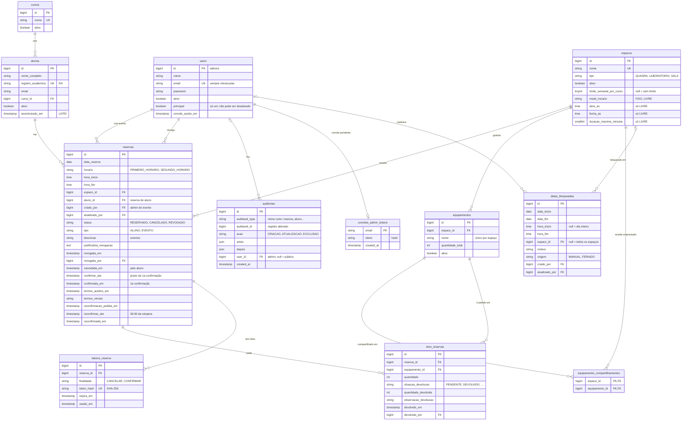

# Banco de dados

Visão do modelo de dados do sistema de reservas e o porquê das principais decisões de modelagem.

> Mais detalhes: [`README.md`](README.md) (regras e endpoints) e [`CHECKLIST.md`](CHECKLIST.md) (o que já existe e o que falta).

Última atualização: 06/11/2026

---

## Diagrama

Todas as tabelas têm `created_at` e `updated_at`. Cursos, alunos, espaços e equipamentos também têm `criado_por` e `atualizado_por` (FK para `users`), omitidos no diagrama para não poluí-lo; `auditorias` se liga a qualquer uma das tabelas auditadas pelo par `auditavel_type`/`auditavel_id`. Ficaram de fora do diagrama as tabelas internas do Laravel: tokens do Sanctum, filas, cache e sessões.

---

## Decisões de modelagem

### Pessoas

**1. Alunos e admins em tabelas separadas (`alunos` e `users`).**
O aluno não faz login: ele se identifica só pelo RA. O admin tem senha e token. Colocar os dois numa tabela só deixaria `password` vazio para quase todo mundo e misturaria regras de acesso diferentes.

**2. O RA é único, mas a chave primária é o `id`.**
O RA é o que o aluno digita, mas pode mudar de formato entre instituições. As chaves estrangeiras usam o `id` numérico, que é estável e mais leve nos índices.

**3. Cursos em tabela, não em enum.**
Os cursos mudam conforme a instituição. Com uma tabela, o sistema pode ser reaproveitado em outras unidades da rede sem mudar código, e o admin cadastra e desativa cursos pela API.

### Espaços e equipamentos

**4. Equipamento pertence a um espaço; o compartilhamento é uma lista escolhida pelo admin (`equipamento_compartilhamentos`).**
Por padrão, um item só aparece e só pode ser pedido no próprio espaço (a bola fica com a quadra, o microscópio com o laboratório). O admin escolhe com quais **outros espaços** cada equipamento é compartilhado; ali ele aparece e é reservado como um item do espaço. Até 13/11/2026 havia uma flag `compartilhavel`, que liberava o item para **todos** os espaços (o usuário viu o microscópio na quadra); ela foi trocada pela tabela (passo 11.2c). Detalhes na decisão 34.

**5. `limite_semanal_por_curso` fica no espaço.**
Cada espaço tem sua regra: a quadra limita a 3 reservas por curso por semana, e as salas não têm limite (`null`). A regra muda pelo cadastro, sem mexer no código.

**6. Não existe coluna de "quantidade disponível" no equipamento.**
A disponibilidade muda a cada data e horário. Um número fixo não representa isso e ficaria errado a cada reserva, cancelamento ou revogação. Ela é **calculada**: `quantidade_total` menos a soma do que está em `item_reservas` nas reservas ativas que se sobrepõem ao horário. A consulta fica centralizada em `DisponibilidadeEquipamentoRepository` e usa índices.

### Reservas

**7. Alunos e eventos na mesma tabela `reservas`, diferenciados por `tipo`.**
Os dois ocupam o espaço da mesma forma, então a verificação de conflito é uma só. O que muda é quem criou: `aluno_id` para o aluno, `criado_por` para o admin no evento.

**8. A reserva guarda `hora_inicio` e `hora_fim`, além do `horario`.** *(usado pelos horários livres desde 09/11/2026)*
Hoje os horários são fixos (19:00 e 20:30). Guardar o intervalo prepara o sistema para horários livres (ex.: 7h às 22h) sem migração de dados. O conflito é verificado por **sobreposição** de intervalos, o que funciona nos dois modelos.

**9. `data_reserva` é gravada como `Y-m-d`, e não como `data`.**
Gravada como texto puro, a data pode ser comparada direto pelo índice; o `whereDate` impediria o uso do índice. O nome não é `data` porque um campo com esse nome fazia o Laravel não envolver a resposta em `{"data": ...}`.

**10. Reserva nunca é apagada: ela muda de `status`.**
Revogar e cancelar só trocam o status (`REVOGADO`, `CANCELADO`). O histórico fica preservado, inclusive quem revogou, quando e por quê (`revogada_por`, `revogada_em`, `justificativa_revogacao`). Só reservas com status `RESERVADO` ocupam horário e equipamentos.

**11. Equipamentos da reserva em `item_reservas`, com quantidade.**
Uma reserva pode pedir vários equipamentos e um equipamento aparece em várias reservas (N:N). A tabela intermediária guarda a quantidade pedida. Um equipamento não se repete na mesma reserva (chave única `reserva_id + equipamento_id`).

**11b. A devolução fica na própria `item_reservas`.**
Cada linha já é "este equipamento, nesta reserva", então a devolução de cada item (situação, quantidade devolvida, observação, quem registrou e quando) mora nela, sem tabela extra. O model `ItemReserva` (um *pivot* do Laravel) dá regras e auditoria à linha sem mudar as relações. O índice `(situacao_devolucao, reserva_id)` atende a busca de pendências.

**12. Colunas de confirmação na própria reserva.**
Criadas no item 9 (`confirmacao_enviada_em`, `confirmada_em`) e refeitas no passo 11.3a (13/11/2026) para as duas etapas: `confirmar_ate`, `confirmada_em`, `termos_aceitos_em`, `termos_versao`, `reconfirmacao_pedida_em`, `reconfirmar_ate`, `reconfirmada_em` (ver decisão 36).

### Bloqueios

**13. Uma tabela só para feriados, recessos e manutenções (`datas_bloqueadas`).**
Feriados importados (`origem = FERIADO`) e bloqueios do admin (`MANUAL`) seguem a mesma regra, então só existe um lugar para consultar. O campo `origem` evita importar o mesmo feriado duas vezes.

**14. Campos opcionais definem o alcance do bloqueio.**
`espaco_id` vazio vale para todos os espaços. `hora_inicio` e `hora_fim` vazios valem para o dia inteiro. `data_inicio` e `data_fim` permitem períodos longos, como o recesso, num registro só.

### Integridade e desempenho

**15. Exclusão é desativação (`ativo`).**
Espaços, equipamentos, cursos e alunos não são apagados: são desativados. As chaves estrangeiras usam `restrictOnDelete` para impedir que o banco apague algo que tem histórico de reservas. `reservas.aluno_id` ainda é `nullOnDelete`, mas a API não apaga alunos.

**16. Índices pensados nas consultas mais frequentes.**
- `reservas (espaco_id, data_reserva)`: conflito de horário e calendário do espaço.
- `reservas (data_reserva, status)`: reservas ativas de um dia ou período.
- `item_reservas (equipamento_id, reserva_id)`: uso de um equipamento.
- `datas_bloqueadas (data_inicio, data_fim)`: bloqueios que atingem uma data.
- `reservas (aluno_id, data_reserva)` e `alunos (curso_id)`: busca por aluno, filtro por curso e limite semanal. O MySQL cria índice para chaves estrangeiras sozinho; o Postgres não, por isso eles são explícitos.

**17. Concorrência resolvida com travas de linha, não com colunas de controle.**
Ao reservar, o sistema trava a linha do espaço e dos equipamentos (`lockForUpdate`) durante a transação. Duas reservas simultâneas no mesmo horário ficam em fila e a segunda vê a primeira.

---

### Auditoria

**18. Colunas `criado_por`/`atualizado_por` mais uma tabela de histórico.**
As colunas respondem rápido "quem criou e quem mexeu por último", sem consulta extra. A tabela `auditorias` responde "o que mudou": cada criação, alteração e exclusão guarda os valores antes e depois (só dos campos alterados), quem fez e quando.

**19. Histórico polimórfico, numa tabela só.**
`auditavel_type` + `auditavel_id` apontam para qualquer tabela auditada. Uma tabela de histórico por entidade multiplicaria migrations e código sem ganho.

**20. Vazio significa "não foi um admin".**
O aluno não tem login, então ações pela rota pública ficam com `criado_por`, `atualizado_por` e `user_id` vazios, o mesmo valendo para comandos como a importação de feriados.

**21. As chaves de auditoria usam `nullOnDelete`.**
Se um admin for removido, os registros e o histórico continuam; só a referência a ele fica vazia.

### LGPD

**22. Aluno é anonimizado, não apagado.**
Quando o aluno pede a exclusão dos dados, nome, RA e email são trocados por valores genéricos e `anonimizado_em` registra quando. As reservas continuam (estatísticas de uso), mas não identificam mais a pessoa. Apagar a linha quebraria o histórico ou deixaria reservas sem dono.

**23. O histórico de auditoria também é anonimizado.**
Os valores antes/depois guardados em `auditorias` repetiriam nome, RA e email; na anonimização eles viram `[anonimizado]`.

**24. RA anonimizado começa com `A`.**
`A` + id com 9 dígitos cabe nos 10 caracteres da coluna, é único e nunca colide com um RA real (só dígitos). O RA original fica livre para um novo cadastro.

### Links por email

**25. Tokens em tabela própria e genérica (`tokens_reserva`).**
Os links dos emails (cancelar agora, confirmar no item 9) usam a mesma tabela, diferenciados por `finalidade`. Uma reserva pode ter vários tokens, cada um com validade (`expira_em`) e uso único (`usado_em`). Colunas de token dentro de `reservas` exigiriam um par de colunas novo a cada finalidade.

**27. Email de admin sempre em minúsculas.**
O model normaliza o email ao gravar (minúsculas, sem espaços nas pontas) e os requests normalizam antes de validar. A unicidade e o login ficam iguais nos três bancos e não existem dois admins para a mesma caixa de email.

**28. Convite e redefinição de senha em tabelas separadas.**
Os dois usam o Password Broker do Laravel (token com hash, um por email). Com a mesma tabela, o broker do convite (2 dias) aceitaria um token de redefinição (60 min). `convites_admin_tokens` tem a mesma estrutura de `password_reset_tokens`.

**29. Senha nunca entra no histórico.**
`users` usa o trait de auditoria como as outras tabelas, mas `password` e `remember_token` aparecem só como `[oculto]` (o trait aceita uma lista de campos sensíveis por model).

**32. Modo de horário é configuração do espaço.**
`modo_horario`, `abre_as`, `fecha_as` e `duracao_maxima_minutos` ficam em `espacos`. No FIXO os três últimos ficam vazios. A reserva não muda: `horario` fica preenchido no FIXO e vazio no LIVRE, e `hora_inicio`/`hora_fim` sempre têm o intervalo real, então conflito, bloqueios, confirmação e cancelamento funcionam igual nos dois modos.

**33. Equipamentos pelo pico de uso, calculado em PHP sobre uma consulta.**
O banco devolve, numa consulta agrupada, o total de cada equipamento por intervalo reservado; o pico (maior uso simultâneo) é calculado em PHP percorrendo inícios e fins em ordem. Fazer isso em SQL exigiria funções de janela, com sintaxe e desempenho diferentes entre SQLite, MySQL e Postgres.

**34. Compartilhamento de equipamento numa tabela de ligação com chave `(espaco_id, equipamento_id)`.**
A consulta mais usada é "quais equipamentos o espaço X pode usar": os do espaço **ou** os que estão na lista dele. Com a chave primária começando por `espaco_id`, essa subconsulta (`WHERE espaco_id = X`) usa o índice da própria chave; o índice extra em `equipamento_id` atende a chave estrangeira (o Postgres não cria sozinho) e a tela do equipamento. É uma tabela pequena (poucas linhas por equipamento) e não acrescenta consulta por item: a lista do espaço continua sendo uma consulta só. Mudanças na lista ficam no histórico como alteração do equipamento (`espacos_compartilhados` antes/depois) e avançam a versão da disponibilidade. Tirar um espaço da lista é recusado (409) se houver reserva futura daquele item naquele espaço. Alternativas avaliadas: compartilhar por tipo de espaço (sem tabela nova, mas o projetor do laboratório não iria para as salas) e manter a flag (liberava tudo para todos).

**35. Horizonte do calendário calculado, sem coluna nova.**
O fim do semestre vem da configuração (`RESERVA_FIM_DOS_SEMESTRES`, padrão `06-30,12-31`) e o mínimo de semanas também (`RESERVA_CALENDARIO_MINIMO_SEMANAS`, 4). A data em que cada dia abre para reserva (`abre_em`) é a inversa da antecedência (`dia − 10 dias úteis`), calculada em PHP. Nada é gravado; quando a grade de aulas (passo 12) existir, a vigência dela pode passar a definir o fim do semestre.

**36. Confirmação em duas etapas com o prazo gravado na reserva.**
`confirmar_ate` (prazo da primeira confirmação, com o aceite dos termos) e `reconfirmar_ate` (prazo da reconfirmação, 00:00 da véspera) ficam gravados, em vez de calculados na hora, porque o comando que revoga roda a cada 15 minutos: com o prazo na coluna e os índices `(status, confirmar_ate)` e `(status, reconfirmar_ate)`, cada execução são duas consultas por índice, sem calcular datas por reserva. `termos_aceitos_em` e `termos_versao` registram o aceite (prova do que foi informado ao aluno, LGPD); a versão vem da configuração e muda quando o texto muda. Substituiu `confirmacao_enviada_em` (o pedido único de 2 dias úteis antes), passo 11.3a, 13/11/2026.

**31. `auditavel_type` guarda nomes curtos (morph map).**
Em vez de `App\Models\Reserva`, a coluna guarda `reserva` (e `aluno`, `espaco`, `equipamento`, `curso`, `data_bloqueada`, `item_reserva`, `admin`). O mapa fica em `TipoAuditavelConstant` e é registrado com `enforceMorphMap` no `AppServiceProvider`: renomear ou mover uma classe não quebra o histórico, e um model polimórfico fora do mapa dá erro em vez de gravar um nome inesperado. Vale também para `personal_access_tokens.tokenable_type` (admins aparecem como `admin`).

**30. Admin principal é uma flag em `users`.**
Uma coluna booleana basta para marcar a conta de manutenção. A garantia de existir só um fica nos comandos (`admin:criar-principal` recusa se já houver um; `admin:transferir-principal` desmarca o atual e marca o novo na mesma transação), porque um índice único parcial (`WHERE principal = true`) não funciona igual nos três bancos.

**26. No banco fica só o hash do token.**
O token puro (64 caracteres aleatórios) só existe no email. O banco guarda o SHA-256, com índice único, então quem tiver acesso ao banco não consegue montar um link válido. SHA-256 sem salt é suficiente aqui porque o token já é aleatório e longo (diferente de uma senha).

---

## Mudanças planejadas

| Mudança | Para quê |
|---|---|
| Clientes de API (passo 13) | Terceiros autorizados, com permissões por cliente e um **responsável** cadastrado (organização, pessoa, email) que aceita os termos de uso da API (versão guardada) |
| Grade de aulas (passo 12) | Ocupação semanal recorrente por espaço (dia da semana, início, fim, vigência, descrição curta), sem professores nem alunos; código do espaço para a importação; índice por espaço e dia da semana |
| Registro de uso posterior (12b) | Origem da reserva gravada na criação (ex.: `origem` = SITE, ADMIN, REGISTRO_POSTERIOR), para a marcação e a cor próprias nas telas do admin e a coluna na exportação |
| Solicitação de equipamento (11.2f) | Situação do item da reserva (ex.: aguardando aprovação, aprovado, recusado) e, talvez, a marca "aceita solicitação" no equipamento; detalhes em aberto |
