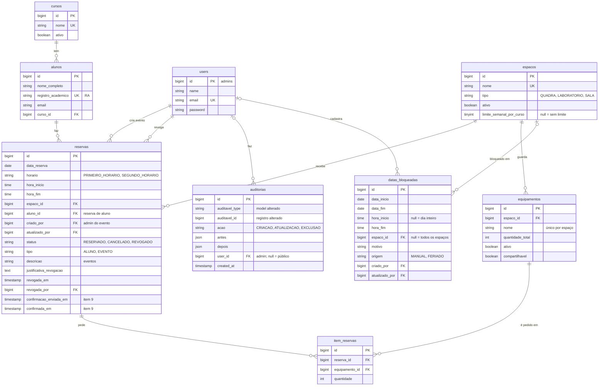

# Banco de dados

Visão do modelo de dados do sistema de reservas e o porquê das principais decisões de modelagem.

> Mais detalhes: [`DOCUMENTACAO.md`](DOCUMENTACAO.md) (regras e endpoints) e [`CHECKLIST.md`](CHECKLIST.md) (o que já existe e o que falta).

Última atualização: 06/11/2026

---

## Diagrama

Todas as tabelas têm `created_at` e `updated_at`. Cursos, alunos, espaços e equipamentos também têm `criado_por` e `atualizado_por` (FK para `users`), omitidos no diagrama para não poluí-lo; `auditorias` se liga a qualquer uma das tabelas auditadas pelo par `auditavel_type`/`auditavel_id`. Ficaram de fora do diagrama as tabelas internas do Laravel: tokens do Sanctum, filas, cache e sessões.

---

## Decisões de modelagem

### Pessoas

**1. Alunos e admins em tabelas separadas (`alunos` e `users`).**
O aluno não faz login: ele se identifica só pelo RA. O admin tem senha e token. Colocar os dois numa tabela só deixaria `password` vazio para quase todo mundo e misturaria regras de acesso diferentes.

**2. O RA é único, mas a chave primária é o `id`.**
O RA é o que o aluno digita, mas pode mudar de formato entre instituições. As chaves estrangeiras usam o `id` numérico, que é estável e mais leve nos índices.

**3. Cursos em tabela, não em enum.**
Os cursos mudam conforme a instituição. Com uma tabela, o sistema pode ser reaproveitado em outras unidades da rede sem mudar código, e o admin cadastra e desativa cursos pela API.

### Espaços e equipamentos

**4. Equipamento pertence a um espaço, com a flag `compartilhavel`.**
Por padrão, um item só pode ser pedido no próprio espaço (a bola fica com a quadra). Itens marcados como compartilháveis, como o microscópio e o projetor, podem ser pedidos em qualquer espaço.

**5. `limite_semanal_por_curso` fica no espaço.**
Cada espaço tem sua regra: a quadra limita a 3 reservas por curso por semana, e as salas não têm limite (`null`). A regra muda pelo cadastro, sem mexer no código.

**6. Não existe coluna de "quantidade disponível" no equipamento.**
A disponibilidade muda a cada data e horário. Um número fixo não representa isso e ficaria errado a cada reserva, cancelamento ou revogação. Ela é **calculada**: `quantidade_total` menos a soma do que está em `item_reservas` nas reservas ativas que se sobrepõem ao horário. A consulta fica centralizada em `DisponibilidadeEquipamentoRepository` e usa índices.

### Reservas

**7. Alunos e eventos na mesma tabela `reservas`, diferenciados por `tipo`.**
Os dois ocupam o espaço da mesma forma, então a verificação de conflito é uma só. O que muda é quem criou: `aluno_id` para o aluno, `criado_por` para o admin no evento.

**8. A reserva guarda `hora_inicio` e `hora_fim`, além do `horario`.**
Hoje os horários são fixos (19:00 e 20:30). Guardar o intervalo prepara o sistema para horários livres (ex.: 7h às 22h) sem migração de dados. O conflito é verificado por **sobreposição** de intervalos, o que funciona nos dois modelos.

**9. `data_reserva` é gravada como `Y-m-d`, e não como `data`.**
Gravada como texto puro, a data pode ser comparada direto pelo índice; o `whereDate` impediria o uso do índice. O nome não é `data` porque um campo com esse nome fazia o Laravel não envolver a resposta em `{"data": ...}`.

**10. Reserva nunca é apagada: ela muda de `status`.**
Revogar e cancelar só trocam o status (`REVOGADO`, `CANCELADO`). O histórico fica preservado, inclusive quem revogou, quando e por quê (`revogada_por`, `revogada_em`, `justificativa_revogacao`). Só reservas com status `RESERVADO` ocupam horário e equipamentos.

**11. Equipamentos da reserva em `item_reservas`, com quantidade.**
Uma reserva pode pedir vários equipamentos e um equipamento aparece em várias reservas (N:N). A tabela intermediária guarda a quantidade pedida. Um equipamento não se repete na mesma reserva (chave única `reserva_id + equipamento_id`).

**12. Colunas de confirmação já existem (`confirmacao_enviada_em`, `confirmada_em`).**
Elas foram criadas para o item 9, para o agendador saber a quem já pediu confirmação e quem já confirmou.

### Bloqueios

**13. Uma tabela só para feriados, recessos e manutenções (`datas_bloqueadas`).**
Feriados importados (`origem = FERIADO`) e bloqueios do admin (`MANUAL`) seguem a mesma regra, então só existe um lugar para consultar. O campo `origem` evita importar o mesmo feriado duas vezes.

**14. Campos opcionais definem o alcance do bloqueio.**
`espaco_id` vazio vale para todos os espaços. `hora_inicio` e `hora_fim` vazios valem para o dia inteiro. `data_inicio` e `data_fim` permitem períodos longos, como o recesso, num registro só.

### Integridade e desempenho

**15. Exclusão é desativação (`ativo`).**
Espaços, equipamentos e cursos não são apagados: são desativados. As chaves estrangeiras usam `restrictOnDelete` para impedir que o banco apague algo que tem histórico de reservas. A exceção hoje é `reservas.aluno_id` (`nullOnDelete`); com a desativação de alunos planejada, aluno também deixa de ser apagado.

**16. Índices pensados nas consultas mais frequentes.**
- `reservas (espaco_id, data_reserva)`: conflito de horário e calendário do espaço.
- `reservas (data_reserva, status)`: reservas ativas de um dia ou período.
- `item_reservas (equipamento_id, reserva_id)`: uso de um equipamento.
- `datas_bloqueadas (data_inicio, data_fim)`: bloqueios que atingem uma data.

**17. Concorrência resolvida com travas de linha, não com colunas de controle.**
Ao reservar, o sistema trava a linha do espaço e dos equipamentos (`lockForUpdate`) durante a transação. Duas reservas simultâneas no mesmo horário ficam em fila e a segunda vê a primeira.

---

### Auditoria

**18. Colunas `criado_por`/`atualizado_por` mais uma tabela de histórico.**
As colunas respondem rápido "quem criou e quem mexeu por último", sem consulta extra. A tabela `auditorias` responde "o que mudou": cada criação, alteração e exclusão guarda os valores antes e depois (só dos campos alterados), quem fez e quando.

**19. Histórico polimórfico, numa tabela só.**
`auditavel_type` + `auditavel_id` apontam para qualquer tabela auditada. Uma tabela de histórico por entidade multiplicaria migrations e código sem ganho.

**20. Vazio significa "não foi um admin".**
O aluno não tem login, então ações pela rota pública ficam com `criado_por`, `atualizado_por` e `user_id` vazios, o mesmo valendo para comandos como a importação de feriados.

**21. As chaves de auditoria usam `nullOnDelete`.**
Se um admin for removido, os registros e o histórico continuam; só a referência a ele fica vazia.

---

## Mudanças planejadas

| Mudança | Para quê |
|---|---|
| Desativação de alunos | Admin remover aluno sem perder o histórico de reservas |
| Cancelamento pelo aluno (item 8) | Status `CANCELADO` e data do cancelamento |
| Configuração de horário por espaço | Horários livres: modo FIXO/LIVRE, janela de funcionamento e duração máxima |
| Clientes de API | Terceiros autorizados, com permissões por cliente |
