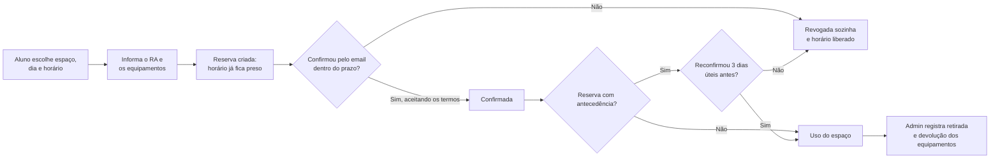
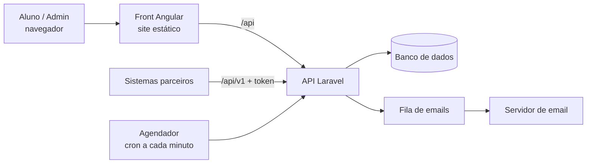

# Sistema de Reservas de Espaços

[](https://github.com/ericjunq/reserva-quadra/actions/workflows/ci.yml)

Sistema web para reservar a quadra, os laboratórios, as salas e os equipamentos de uma faculdade. O aluno reserva pelo site sem criar conta e confirma pelo email. Os funcionários administram tudo num painel próprio, e sistemas parceiros autorizados podem usar uma API versionada.

O projeto tem duas partes neste repositório:

- **API** em Laravel 13 (raiz do repositório), onde ficam as regras de negócio;
- **front-end** em Angular 22 ([`frontend/`](frontend/)), que só consome a API e tem deploy próprio.

---

## Sumário

1. [O problema e o propósito](#o-problema-e-o-propósito)
2. [O que o sistema faz](#o-que-o-sistema-faz)
3. [Como funciona uma reserva](#como-funciona-uma-reserva)
4. [Regras principais](#regras-principais)
5. [Privacidade e LGPD](#privacidade-e-lgpd)
6. [Segurança](#segurança)
7. [Arquitetura e tecnologias](#arquitetura-e-tecnologias)
8. [Estrutura do repositório](#estrutura-do-repositório)
9. [Como rodar](#como-rodar)
10. [Testes e CI](#testes-e-ci)
11. [Implantação](#implantação)
12. [API para sistemas parceiros](#api-para-sistemas-parceiros)
13. [Situação do projeto](#situação-do-projeto)
14. [Documentação](#documentação)
15. [Como contribuir](#como-contribuir)

---

## O problema e o propósito

Numa faculdade, os espaços compartilhados costumam ser reservados por conversa, planilha ou caderno na secretaria. Isso gera problemas conhecidos:

- **dois grupos no mesmo horário**, porque ninguém vê a agenda atualizada;
- **horários presos por quem não aparece**, sem jeito de liberar a tempo para outra pessoa;
- **um curso ou uma atlética ocupando a quadra a semana toda**, sem limite justo;
- **equipamentos sem controle**: não se sabe quem levou a bola, o projetor ou o microscópio, nem em que estado voltou;
- **dados de alunos espalhados** em planilhas e mensagens, sem cuidado com a LGPD.

O sistema resolve isso com uma agenda única e pública, em que:

- o aluno vê na hora o que está livre e reserva sozinho, a qualquer hora;
- cada reserva precisa ser **confirmada pelo email**, então quem não confirma perde o horário automaticamente e ele volta a ficar livre;
- a quadra tem **limite semanal por curso**;
- os equipamentos têm **estoque, retirada e devolução** registrados;
- os funcionários têm um painel para eventos, bloqueios, cadastros e histórico de tudo o que mudou;
- os dados pessoais seguem a LGPD do começo ao fim.

O sistema começou pela quadra (usada pelas atléticas) e foi generalizado para laboratórios e salas, cada um com as próprias regras de horário.

---

## O que o sistema faz

### Para o aluno (sem login)

- **Calendário de cada espaço** até o fim do semestre, com o que está livre, reservado, em evento ou bloqueado. O público vê só "Reservado", nunca quem reservou.
- **Reserva em poucos passos:** escolhe o espaço, o dia e o horário, informa o RA e, se quiser, os equipamentos e as quantidades.
- **Horário fixo ou livre:** a quadra tem dois horários fixos à noite; laboratórios e salas aceitam início e fim escolhidos pelo aluno, de 15 em 15 minutos, dentro da janela do espaço.
- **Pedido de equipamento de outro espaço**, que o admin aprova ou recusa dentro de um prazo.
- **Confirmação pelo email**, com aceite dos termos de uso e do aviso de privacidade.
- **Minhas reservas:** consulta das próprias reservas com RA + email, reenvio do email de confirmação e situação da devolução.
- **Cancelamento** pelo link do email.
- **Cadastro do aluno** com aviso claro de como os dados são usados.

### Para o admin (com login e código por email)

- **Painel** com pedidos de equipamento aguardando resposta, equipamentos fora agora e sugestões de compartilhamento.
- **Reservas:** lista com filtros e totais, detalhe com a linha do tempo, revogação com justificativa, exportação em CSV com aviso de dados pessoais.
- **Calendário do admin** com quem reservou, eventos e bloqueios, e atalhos para reservar ou registrar um uso.
- **Eventos da faculdade**, que podem ocupar um horário já reservado (com justificativa e aviso ao aluno).
- **Reserva para um aluno** feita no balcão, com as mesmas regras do site.
- **Registro de uso posterior**, para quem usou um espaço sem reservar.
- **Equipamentos:** estoque com movimentações (entrada, manutenção, baixa, ajuste), retirada, devolução com avaria ou falta, e compartilhamento entre espaços.
- **Cadastros:** espaços, equipamentos, cursos, datas bloqueadas (com importação automática de feriados), alunos (com anonimização) e admins (por convite).
- **Histórico de auditoria:** quem mudou o quê, quando, com os valores de antes e depois.
- **Sistemas parceiros:** cadastro, envio dos termos da API ao responsável, renovação e revogação do acesso.

### Tarefas automáticas

O agendador revoga as reservas não confirmadas, pede a reconfirmação perto da data, encerra os pedidos de equipamento sem resposta, apaga links e códigos vencidos, importa os feriados do ano seguinte e avisa os parceiros com acesso perto de vencer. Falhas viram alertas por email aos admins, sem dados pessoais.

---

## Como funciona uma reserva



- O prazo para confirmar é de **24 horas** (ou **1 hora** para uma reserva no mesmo dia), nunca depois do início.
- O aluno pode **cancelar** pelo link do email até o início da reserva.
- O admin pode **revogar** com justificativa; o aluno recebe um email com o motivo.

---

## Regras principais

| Regra | Valor padrão |
|---|---|
| Antecedência máxima para reservar | 10 dias úteis |
| Dias que aceitam reserva de aluno | Segunda a sexta, fora de feriados e datas bloqueadas |
| Horários da quadra | 19:00–20:30 e 20:30–22:00 |
| Horário livre (labs e salas) | Início e fim arredondados a 15 min, dentro da janela e da duração máxima do espaço |
| Reserva para hoje | Aceita até 20 minutos antes do fim do horário |
| Limite da quadra | 3 reservas por curso de segunda a sexta |
| Confirmação | 24 h depois de reservar (1 h no mesmo dia) |
| Reconfirmação | Pedida 3 dias úteis antes, com prazo até a véspera |
| Prazo do admin para responder pedido de equipamento | 24 h antes do início (3 h no prazo curto; presencial se não houver tempo) |
| Disponível de um equipamento | Estoque utilizável menos o pico de uso no intervalo, em qualquer espaço |

Os valores ficam em [`config/reservas.php`](config/reservas.php) e podem ser alterados pelo `.env`. Eventos da faculdade podem cair em fim de semana, ignoram os bloqueios e não precisam de confirmação. Nada é apagado: espaços, equipamentos, cursos e admins são desativados, e alunos podem ser anonimizados.

A lista completa de regras, com os códigos de erro, está na [documentação de desenvolvimento](DOCUMENTACAO.md#6-regras-de-negócio).

---

## Privacidade e LGPD

A LGPD orienta todas as decisões do projeto, não só as telas que mostram dados pessoais.

- **Coleta mínima:** do aluno, só nome, RA, email e curso; do admin, nome e email.
- **Exposição mínima:** as rotas públicas nunca mostram RA, email, nome ou curso de quem reservou. O público vê "Reservado"; quem reservou, só os admins.
- **Nada pessoal em URL ou log:** RA, email e buscas por nome vão sempre no corpo de requisições `POST`. Os logs são apagados em 14 dias e os erros de regra de negócio nem chegam a eles.
- **Dois identificadores:** para consultar as próprias reservas, o aluno informa RA **e** email.
- **Respostas genéricas** onde a diferença revelaria se alguém está cadastrado (consulta de reservas, "esqueci a senha", links inválidos).
- **Aceite registrado:** a confirmação da reserva grava a data e a versão dos termos aceitos.
- **Retenção definida:** links de email são apagados 30 dias depois de usados ou vencidos, jobs que falharam em 7 dias, códigos de login em 1 dia.
- **Direitos do titular:** o admin corrige os dados do aluno e pode **anonimizá-lo** a pedido, inclusive no histórico de auditoria. O responsável por um evento também pode ser removido a pedido.
- **Transparência:** o aluno recebe email a cada mudança na reserva (confirmação, cancelamento, revogação, pendência na devolução).
- **Sem rastreamento:** sem Google Fonts, analytics ou recursos de outros domínios; a fonte é servida pelo próprio site.

O texto dos termos de uso e do aviso de privacidade ([`app/Support/Termos.php`](app/Support/Termos.php)) ainda é um rascunho, a validar com a instituição.

---

## Segurança

- **Login do admin em duas etapas:** senha e um código de 6 dígitos enviado por email, com validade, uso único e limite de tentativas.
- **Tokens com validade:** sessão do admin de 8 horas; token de parceiro de 12 meses, com permissões por rota. Links de email guardados só como hash SHA-256.
- **Rotas protegidas por teste:** um teste percorre todas as rotas e falha se uma rota do admin ou da API de parceiros ficar sem proteção.
- **Limites de requisições** por IP e por pessoa (com HMAC do RA, que nunca vai em claro para o cache).
- **Concorrência:** reservas simultâneas usam travas de linha dentro de transações, então dois alunos não pegam o mesmo horário nem o último equipamento.
- **Cabeçalhos HTTP:** HSTS, `nosniff`, `X-Frame-Options: DENY`, `Referrer-Policy: no-referrer` e, no front, CSP só `'self'`.
- **Auditoria** de toda criação, alteração e exclusão, com senhas sempre ocultas.
- **Verificação de produção:** `php artisan sistema:verificar-producao` confere a configuração antes de ir ao ar.

---

## Arquitetura e tecnologias



| Camada | Tecnologias |
|---|---|
| API | PHP 8.3+, Laravel 13, Laravel Sanctum, Yasumi (feriados), Scramble (OpenAPI, só em desenvolvimento) |
| Banco | SQLite em desenvolvimento; testado também em MySQL 8 e Postgres 16 |
| Front | Angular 22 (standalone, signals, sem zone.js), Tailwind CSS 4, ícones Lucide |
| Testes | PHPUnit, Vitest, Playwright e axe (acessibilidade WCAG A e AA) |
| Qualidade | Laravel Pint, Prettier, GitHub Actions |

**Na API**, cada camada tem um papel só: o *FormRequest* valida a entrada, o *controller* é fino, o *service* guarda a regra de negócio, o *repository* só existe para consultas complexas ou reaproveitadas, e o *resource* formata a resposta. Regras violadas viram `409` (conflito) ou `422` (regra) com uma mensagem em português.

**Desempenho** é prioridade em toda decisão: eager loading em todas as listagens (os testes contam as consultas para pegar N+1), cálculos agrupados no banco em vez de consultas em loop, índices alinhados às consultas, exportação em fluxo e respostas enxutas. No front, cada tela é um pacote carregado sob demanda e o aluno nunca baixa o código do admin; o calendário só recarrega quando algo mudou, consultando uma versão de poucos bytes.

---

## Estrutura do repositório

```
.
├── app/
│   ├── Console/Commands/   comandos do agendador e de manutenção
│   ├── Constants/          enums (status, horários, tipos, permissões)
│   ├── Http/
│   │   ├── Controllers/    controllers finos (V1/ = API de parceiros)
│   │   ├── Requests/       validação da entrada
│   │   ├── Resources/      formato das respostas JSON
│   │   └── Middleware/     admin ativo, parceiro ativo, cabeçalhos de segurança
│   ├── Models/             models Eloquent (com auditoria automática)
│   ├── Services/           regras de negócio
│   ├── Repositories/       consultas complexas (disponibilidade de equipamentos)
│   ├── Rules/              validações reutilizáveis
│   ├── Mail/               emails do sistema
│   └── Support/            termos, horizonte do calendário, intervalos
├── config/reservas.php     parâmetros do negócio (lidos do .env)
├── database/               migrations, factories e seeders
├── routes/                 api.php e console.php (agendador)
├── tests/Feature/          testes da API, um arquivo por assunto
├── docs/                   guia e especificação OpenAPI da API de parceiros
├── frontend/
│   ├── src/app/publico/    área do aluno
│   ├── src/app/admin/      área do admin (carregada só para quem entra)
│   ├── src/app/nucleo/     sessão, interceptor e formato de erro
│   ├── e2e/                testes no navegador (Playwright)
│   └── deploy/nginx.conf   exemplo de servidor do front com CSP
└── .github/workflows/      CI
```

O detalhe de cada pasta, inclusive tela por tela do front, está na [documentação de desenvolvimento](DOCUMENTACAO.md#3-estrutura-do-código).

---

## Como rodar

### Pré-requisitos

- PHP 8.3 ou mais novo e Composer;
- Node 22.22+, 24.15+ ou 26 e npm.

### API

```bash
composer install
cp .env.example .env
php artisan key:generate
php artisan migrate:fresh --seed
php artisan serve
```

A API fica em http://localhost:8000. O `--seed` cria os cursos, o admin inicial (definido em `ADMIN_INICIAL_*` no `.env`) e, com `APP_ENV=local`, dados de demonstração: quadra, laboratórios, salas, equipamentos e alunos.

Em outro terminal, rode o agendador. Em desenvolvimento ele também envia os emails da fila a cada minuto:

```bash
php artisan schedule:work
```

Com `MAIL_MAILER=log`, os emails aparecem em `storage/logs/laravel.log`. Para recebê-los numa caixa de teste (Mailtrap, Resend), veja ["Enviar emails de verdade"](DOCUMENTACAO.md#enviar-emails-de-verdade-teste-local).

### Front-end

```bash
cd frontend
npm install
npm start
```

O site fica em http://localhost:4200. O painel do admin fica em http://localhost:4200/admin. O login pede a senha e depois um código enviado por email; em desenvolvimento, dá para desligar o código com `LOGIN_COM_CODIGO=false` no `.env`.

### Comandos úteis

| Comando | O que faz |
|---|---|
| `php artisan schedule:list` | Mostra as tarefas automáticas e a próxima execução |
| `php artisan feriados:importar 2027` | Importa os feriados nacionais como datas bloqueadas |
| `php artisan admin:criar-principal` | Cria o admin principal (produção) |
| `php artisan sistema:verificar-producao` | Confere a configuração de produção |
| `php artisan queue:work` | Envia os emails da fila em segundos (opcional em desenvolvimento) |

Todas as variáveis de ambiente estão explicadas na [documentação de desenvolvimento](DOCUMENTACAO.md#variáveis-de-ambiente-do-negócio).

---

## Testes e CI

```bash
php artisan test                 # API (feature tests)
./vendor/bin/pint                # formatação da API

cd frontend
npx ng test --watch=false        # testes de unidade (Vitest)
npx ng build                     # build de produção, com orçamento de tamanho
npx playwright test              # testes no navegador, no computador e no celular
npx prettier --check src e2e     # formatação do front
```

Os testes da API usam uma data fixa (segunda, 09/11/2026, 10:00) para não dependerem do dia em que rodam. Os testes no navegador simulam a API e clicam como uma pessoa, incluindo verificações de acessibilidade em todas as páginas e da CSP do front.

O [CI](.github/workflows/ci.yml) roda a cada push e pull request na `main`: Pint, `composer audit`, os testes da API em **SQLite, MySQL e Postgres**, e o front completo (Prettier, unidade, build, `npm audit` e Playwright).

---

## Implantação

- [`DEPLOY.md`](DEPLOY.md): passo a passo da implantação (servidor, HTTPS, banco, fila com supervisor ou pelo agendador, cron, front com Nginx).
- [`HOSPEDAGEM.md`](HOSPEDAGEM.md): opções de hospedagem e a recomendação, com as perguntas para a TI da instituição.
- Exemplo de configuração de produção: [`.env.production.example`](.env.production.example).

---

## API para sistemas parceiros

Sistemas autorizados pela instituição (portal acadêmico, aplicativo de atlética etc.) usam a API em `/api/v1`, separada das rotas do front para não mudar quando o front muda.

- O admin cadastra o sistema e a pessoa responsável; ela aceita os termos de uso da API e recebe o token uma única vez.
- Permissões por rota: `espacos:ler`, `reservas:criar`, `reservas:ler` e `reservas:cancelar`.
- O parceiro só vê e cancela as próprias reservas, sem dados pessoais dos alunos.

Guia para desenvolvedores: [`docs/API-PARCEIROS.md`](docs/API-PARCEIROS.md). Especificação OpenAPI: [`docs/api-v1.openapi.json`](docs/api-v1.openapi.json) (em desenvolvimento, navegável em http://localhost:8000/docs/api).

---

## Situação do projeto

**Pronto:** a API completa, a área pública, o painel do admin, a API para parceiros, o estoque com retirada e devolução, e a preparação para produção.

**Próximos passos:**

- **Grade de aulas:** importar a grade da faculdade para ocupar os espaços nos horários de aula (aguarda o formato do arquivo da instituição);
- **Importação de equipamentos** por planilha;
- **Com a instituição:** serviço de email de produção, hospedagem, backup, monitoramento externo e revisão dos termos.

O plano detalhado e o estado atual ficam no [`CHECKLIST.md`](CHECKLIST.md).

---

## Documentação

| Arquivo | Conteúdo |
|---|---|
| [`DOCUMENTACAO.md`](DOCUMENTACAO.md) | Documentação completa de desenvolvimento: variáveis de ambiente, endpoints, regras de negócio com códigos de erro, decisões tomadas, testes e histórico |
| [`DATABASE.md`](DATABASE.md) | Diagrama do banco e decisões de modelagem |
| [`CHECKLIST.md`](CHECKLIST.md) | Estado do sistema, plano até a finalização e trilha das decisões |
| [`DEPLOY.md`](DEPLOY.md) e [`HOSPEDAGEM.md`](HOSPEDAGEM.md) | Implantação e escolha da hospedagem |
| [`docs/API-PARCEIROS.md`](docs/API-PARCEIROS.md) | Guia da API para sistemas parceiros |
| [`implementacoes-com-claude-code.txt`](implementacoes-com-claude-code.txt) | Registro de cada implementação, arquivo por arquivo, com o porquê das escolhas |
| [`CLAUDE.md`](CLAUDE.md) e [`PROMPT-IA.md`](PROMPT-IA.md) | Regras de trabalho para continuar o projeto com uma IA |

---

## Como contribuir

- **Sem comentários no código** (PHP, TypeScript, HTML e CSS): as explicações ficam no `implementacoes-com-claude-code.txt`.
- **Nomes em português** para o domínio (`criar`, `listarPaginado`, `detalhar`).
- **Compatível com SQLite, MySQL e Postgres:** nada de SQL específico de um banco.
- **Testes em todo comportamento novo**, e toda página nova entra no teste de acessibilidade.
- **Um commit por alteração**, no padrão [Conventional Commits](https://www.conventionalcommits.org/pt-br/), com Pint e Prettier rodados antes.

As regras completas estão no [`CLAUDE.md`](CLAUDE.md).
